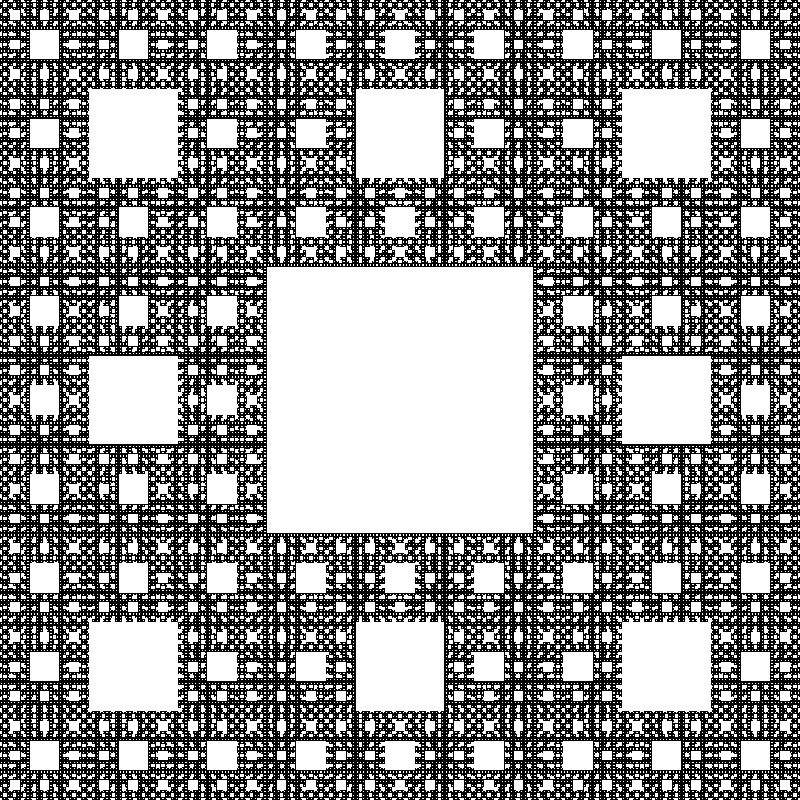
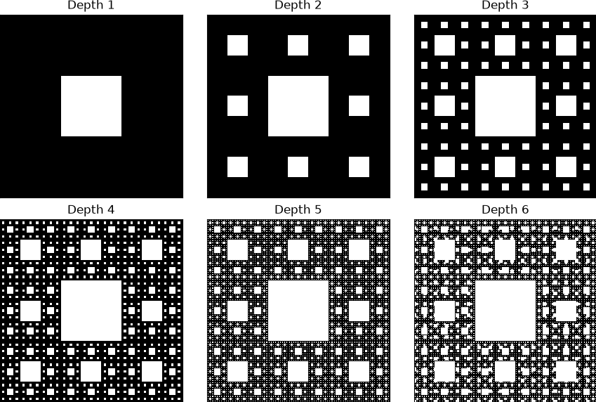
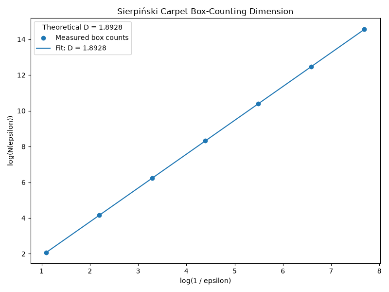
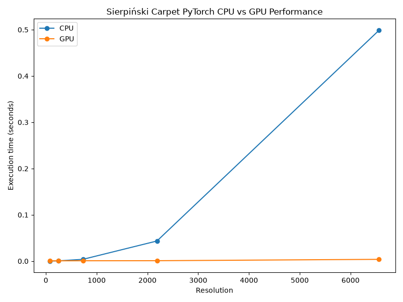

# COMP3710 Sierpiński Carpet

## Overview

This project implements and analyses the Sierpiński carpet using PyTorch tensor operations, with GPU execution intended for UQ Rangpur. The implementation avoids Python loops over individual pixels and instead uses vectorised PyTorch tensor operations and broadcasting.

## Mathematical Construction

The Sierpiński carpet is constructed as follows:

1. Start with a square.
2. Divide it into a 3 x 3 grid.
3. Remove the centre square.
4. Repeat the process on the remaining 8 squares.

For recursion depth `depth`, the implementation uses:

```python
resolution = 3 ** depth
```

This gives an exact grid because each recursion level divides the image side length by 3. The number of retained smallest squares is:

```python
retained smallest squares = 8 ** depth
```

The theoretical fractal dimension is:

```text
D = log(8) / log(3) ≈ 1.8928
```

## PyTorch Implementation

[src/sierpinski.py](src/sierpinski.py) uses a base-3 membership algorithm. Each pixel coordinate is tested digit by digit in base 3. At each recursion level:

```python
x % 3 == 1
y % 3 == 1
```

identify whether the current ternary digit lies in the middle third along the x or y direction. A pixel is removed when both its x and y ternary digits are 1 at the same recursion level, because that places it in the centre square of the current 3 x 3 subdivision.

Broadcasting applies this test across the full two-dimensional grid:

```python
y_middle[:, None] & x_middle[None, :]
```

The only Python loop is over recursion depth, not over individual pixels.

## GPU Execution

The code selects CUDA when available and otherwise uses CPU execution. On UQ Rangpur, the project is run through Slurm on NVIDIA A100-PCIE-40GB GPUs.

## Results



The baseline render uses `depth = 7`, giving a `2187 x 2187` image. The retained pixel count is:

```text
8 ** 7 = 2,097,152
```

## Self-Similarity Across Depth



Depths 1 through 6 demonstrate recursive self-similarity: the same centre-removal pattern appears at progressively smaller scales.

## Box-Counting Fractal Dimension



The box-counting analysis divides the Boolean carpet mask into non-overlapping boxes of different sizes and counts how many boxes contain at least one retained pixel.

For a fractal:

```text
N(epsilon) proportional to epsilon ** (-D)
```

Therefore:

```text
log(N(epsilon)) = D * log(1 / epsilon) + constant
```

The measured dimension is approximately `1.8928`, agreeing with the theoretical value:

```text
log(8) / log(3) ≈ 1.8928
```

## CPU vs GPU Performance



| Depth | Resolution | CPU (s) | GPU (s) | Speedup |
|---:|---:|---:|---:|---:|
| 4 | 81 | 0.000208 | 0.000629 | 0.331x |
| 5 | 243 | 0.000550 | 0.000651 | 0.846x |
| 6 | 729 | 0.003851 | 0.000778 | 4.951x |
| 7 | 2187 | 0.043445 | 0.000883 | 49.220x |
| 8 | 6561 | 0.498645 | 0.003819 | 130.561x |

Small workloads do not necessarily benefit from GPU execution because fixed GPU overhead can dominate. As the tensor size grows, GPU parallelism becomes increasingly useful. At depth 8, the tested A100 system achieved approximately a `130.6x` speedup over the CPU implementation.

## Project Structure

- [src/sierpinski.py](src/sierpinski.py): Generates the baseline depth-7 Sierpiński carpet image.
- [src/depth_progression.py](src/depth_progression.py): Visualises depths 1 through 6 in a single figure.
- [src/fractal_dimension.py](src/fractal_dimension.py): Performs box-counting fractal-dimension analysis.
- [src/benchmark.py](src/benchmark.py): Benchmarks CPU and GPU PyTorch generation performance.
- [jobs/render_job.sh](jobs/render_job.sh): Slurm job for the baseline render.
- [jobs/depth_progression_job.sh](jobs/depth_progression_job.sh): Slurm job for the depth progression render.
- [jobs/fractal_dimension_job.sh](jobs/fractal_dimension_job.sh): Slurm job for box-counting analysis.
- [jobs/benchmark_job.sh](jobs/benchmark_job.sh): Slurm job for CPU/GPU benchmarking.
- [outputs/](outputs): Generated figures and Slurm output/error logs.
- [prompts.md](prompts.md): AI-assisted development log.

## Running on Rangpur

From the project root:

```bash
sbatch jobs/render_job.sh
sbatch jobs/depth_progression_job.sh
sbatch jobs/fractal_dimension_job.sh
sbatch jobs/benchmark_job.sh
```

Results and Slurm logs are written to `outputs/`.

## AI-Assisted Development

AI tools were used as permitted by the COMP3710 lab instructions. Prompts and concise summaries of AI-assisted development are documented in [prompts.md](prompts.md). Hidden chain-of-thought or private reasoning was not recorded.

## Key Findings

- The Sierpiński carpet can be generated using vectorised PyTorch tensor operations.
- Its self-similar structure produces 8 retained copies at a scale factor of 1/3.
- The measured box-counting dimension agrees with the theoretical value of approximately 1.8928.
- GPU execution becomes substantially faster for large tensor resolutions, reaching about 130.6x speedup at depth 8 on the tested A100 system.
